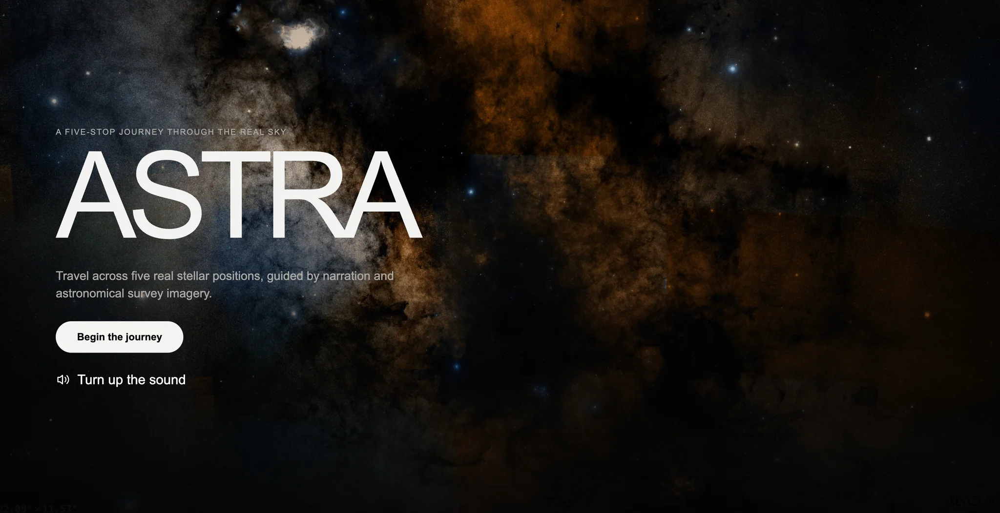

# ASTRA

A narrated journey through five real stars: **Antares → Sirius → Tarazed → Rigel → Aldebaran**.
Real astronomical imagery, cinematic camera movement, and a mobile-first interface.

**[Open ASTRA](https://astra.renoviolab.com.br)**

- Aladin Lite 3.6.4 + DSS2 survey imagery. Internet and WebGL 2 required.
- Seven pre-generated narration files. No runtime TTS, API keys, or backend.
- Final release: **v8.6.1**. Recovered history: **23 snapshots**, starting with the original coordinate map.

## Run locally

```sh
python3 -m http.server 8080 --directory public
```

Open http://localhost:8080, then select **Begin the journey** to enable audio.

## Deploy

**Cloudflare Workers:** run `npx wrangler@4 deploy` from the repository root.
`wrangler.jsonc` serves only `public/`.

**Cloudflare Pages:** connect this repository, use `main`, framework **None**,
build command `exit 0`, and output directory `public`. No environment variables.

Music is optional. The supplied film soundtrack is excluded from public history;
add your own licensed file via [the audio setup](docs/AUDIO.md).

[History and provenance](docs/HISTORY.md) · [Validation](docs/VALIDATION.md) · [Credits](docs/CREDITS.md)

Independent, unofficial experiment. Concept, product direction and QA by Victor
Alexandre; implementation produced and refined with AI. Not affiliated with OpenAI.
